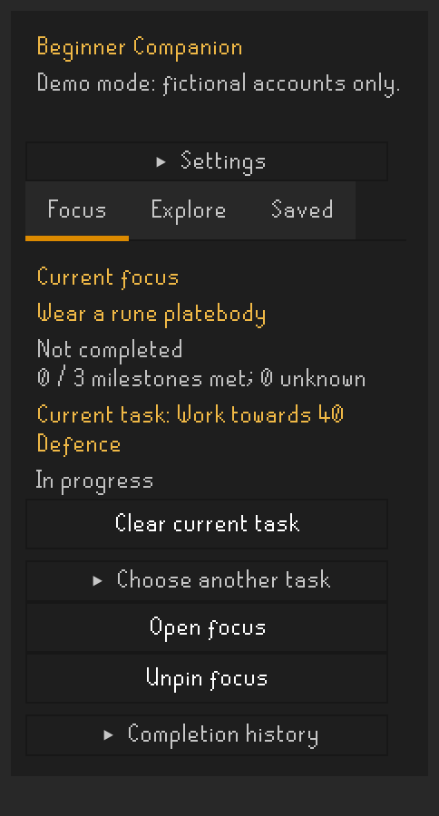
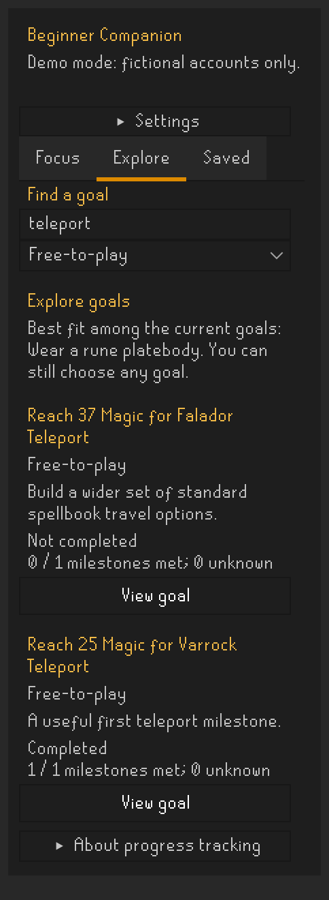
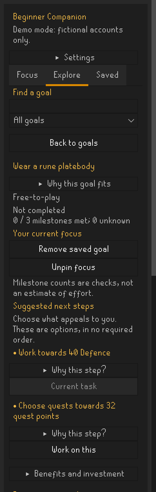
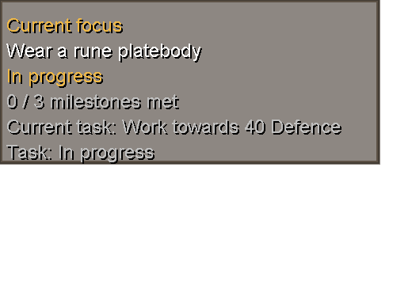
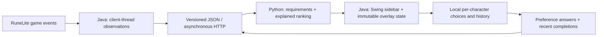

# OSRS Beginner Companion

**Choose a meaningful goal. Pick what to work on next. Keep your own route.**

A Java RuneLite plugin and Python recommendation service for new Old School RuneScape
players. It turns the question “what should I aim for?” into a small set of explained
options, with live progress, a pinned goal and a current task.

This is a personal portfolio project exploring event-driven UI, typed service contracts
and explainable recommendations beyond a conventional web application.

## See it

<table>
<tr><th>Focus: goal and current task</th><th>Explore: searchable goals</th><th>Details: optional next steps</th></tr>
<tr>
<td valign="top"></td>
<td valign="top"></td>
<td valign="top"></td>
</tr>
</table>



These are reproducible captures of the real Swing panel and RuneLite overlay renderer,
using fictional fixtures and RuneLite's theme. The overlay is rendered in isolation,
not over captured gameplay. No real account or login information is pictured.
See [screenshot generation](docs/screenshots.md).

## What it does

- **Choose:** explore 15 curated quest, combat, travel and skilling goals. Search by title
  or summary and filter by free-to-play/member access.
- **Understand:** inspect benefits, investment guidance, requirements and source links.
  Missing observations stay unknown; milestone counts are not time estimates.
- **Focus:** save goals, pin one, and select an optional next step as your current task.
  The movable overlay keeps it visible while the sidebar is closed.
- **Adapt:** suggestions combine interest/commitment answers with curated follow-ups to
  recently observed completions. Each recommendation explains its fit; nothing is auto-selected.
- **Remember:** goals, tasks and completion history are stored locally per character.
  Initial completed observations establish a baseline, rather than a false recent history.

The catalogue includes rune platebody progression, Ardougne cloak 1, early quests such as
Cook's Assistant and Rune Mysteries, Magic teleport milestones, and early gathering/food goals.

## Architecture



**Java has a concrete client role.** RuneLite events trigger observation snapshots on the
client thread. HTTP and disk I/O run off the UI/game threads; Swing owns presentation state.
The overlay receives immutable snapshots and independently checks login/account identity.

**Python owns the domain decisions.** A curated catalogue drives requirement evaluation,
next steps and deterministic ranking. Pydantic models validate input; exported schemas and
shared fixtures keep the Java/Python boundary explicit. It uses no machine learning.

### Engineering decisions worth inspecting

| Problem | Implementation |
| --- | --- |
| Live updates can arrive out of order | Session/revision checks reject stale responses; pending observations are coalesced. |
| Refreshes used to reset scrolling | Keep the last confirmed view during HTTP requests, restore viewport position, and preserve expanded sections. |
| Missing data can look like unfinished work | Distinguish completed, incomplete and unknown; unknown tasks prompt a check instead of repeating an activity. |
| An existing account already has achievements | Baseline first-seen completions; record a confirmed incomplete-to-complete transition once, including across restarts. |
| History could overwhelm explicit preferences | One bounded recency bonus, gated by selected interests; access and completion exclusions take priority. |
| Saved data can be interrupted or belong to another character | Serial atomic file replacement, account-isolated state, and backward-compatible optional fields. |

Recent follow-ups get +3 within seven days and +1 up to thirty days, then no bonus.
Dates represent when completion was observed, not necessarily when it happened in game.
Unconfirmed, unknown-ID and future-dated events do not influence ranking.

## Run locally

Requires **Python 3.10+**, **JDK 17** (`java` and `javac` on PATH), and network access to
resolve dependencies. Commands below are for Windows PowerShell, from the repository root.
Java source targets Java 11; the development runtime uses JDK 17. Gradle is provided by the wrapper.

```powershell
python -m venv .venv
.\.venv\Scripts\python -m pip install -e ".[api,api-test]"
.\.venv\Scripts\python -m uvicorn beginner_companion.api.app:app --host 127.0.0.1 --port 8765
```

In another terminal:

```powershell
.\plugin\gradlew.bat -p plugin --gradle-user-home .gradle-local run --no-daemon
```

Open the gold **G** sidebar, expand **Settings**, choose a fictional demo account and click
**Check demo account**. Explore a goal, pin it, return to **Focus**, and choose **Work on this**.
Five demos cover fresh, partial, complete, unclaimed and unknown progress. No OSRS login
is needed for the demo sidebar; the in-game overlay appears only for a logged-in character.

For live progress, use **Live character** mode and log in through RuneLite. Authentication
stays with RuneLite; this plugin does not handle passwords or login tokens.

For a console-only example of the Java/Python boundary:

```powershell
.\bridge-java\setup.ps1
.\bridge-java\run.ps1 -Fixture contracts/fixtures/preferences-combat.request.json
```

## Verify

```powershell
.\.venv\Scripts\python -m unittest discover -s tests -v
.\plugin\gradlew.bat -p plugin --gradle-user-home .gradle-local test --no-daemon
.\bridge-java\setup.ps1
.\.venv\Scripts\python scripts/verify_bridge.py
```

Current coverage: **34 Python tests and 20 Java tests**, plus a real Java → HTTP → Python
→ Java verification script. Tests cover threshold boundaries, unknown progress, matching,
recency, persistence, character isolation, stale responses, task selection, overlay guards
and scroll preservation. The bridge script starts/stops its own loopback service.
These checks do not establish exhaustive in-game compatibility or Plugin Hub approval.

## Project map

```text
beginner_companion/
  api/             FastAPI endpoints and strict wire models
  domain/          Catalogue, requirement evaluation, next steps and ranking
plugin/            RuneLite UI, observations, overlay and local persistence
bridge-java/       Shared HTTP client and standalone caller
contracts/         JSON schemas and fictional request/response fixtures
tests/             Python domain/API tests
scripts/           End-to-end verification and publication audit
docs/              Screenshots, delivery notes and privacy review
LICENSES/          Upstream licences and notices
```

## Scope and next work

This is an independent **development prototype**, not a published or approved Plugin Hub
plugin. It performs no automatic gameplay, movement or game input.

- Live tracking reads skill levels/XP, seven relevant quests, quest points and membership.
- Diary task/reward-claim mappings remain unverified and therefore unknown.
- Rune platebody use is remembered only if observed during the plugin session.
- The Python service currently runs locally; hosted/packaged delivery remains future work.
- Preference answers last for the plugin session. Saved goals, tasks and history persist.
- Investment bands are qualitative; they are not measured completion-time forecasts.

Next: beginner playtesting, broader curated follow-up relationships, verified diary data,
and a reviewed distribution approach. See [roadmap](docs/beginner-companion-plan.md) and
[delivery options](docs/delivery-options.md).

## Privacy and licensing

Only fictional fixtures are committed. Character keys, saved goals and history stay in the
ignored `data/private/` directory. Character names/account hashes are not sent to Python;
requests contain game observations, preferences, random session/revision identifiers and
up to fifty completion goal IDs/timestamps. This is a local-data design, not anonymisation
of all gameplay observations. Logs, credentials, account exports and build caches are ignored.

Original code is **MIT licensed**. The wiki-derived catalogue and generated response fixtures
are **CC BY-NC-SA 3.0**, with source attribution. They are not covered by the MIT grant.
RuneLite and the Gradle wrapper retain their upstream licences; OSRS trademarks remain
with Jagex. See [LICENSE](LICENSE), [attribution and licence scope](THIRD_PARTY_NOTICES.md),
and the [publication privacy review](docs/privacy-review.md).

[Plugin usage](plugin/README.md) · [Message contracts](contracts/README.md) ·
[Source separation](docs/separation.md)
